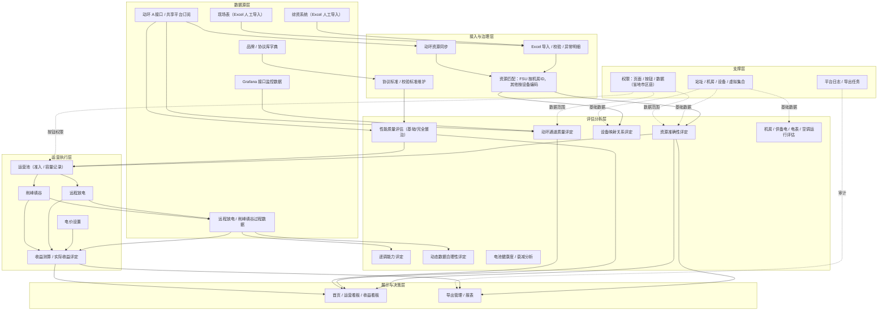
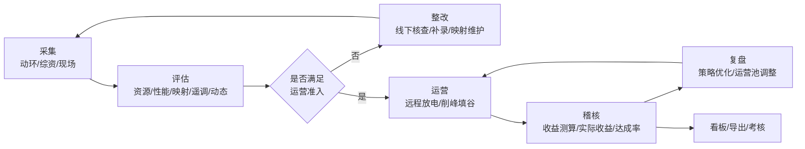
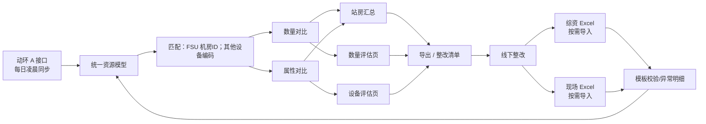
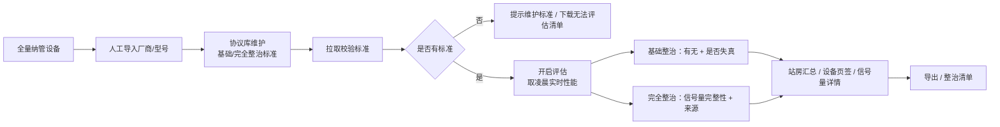
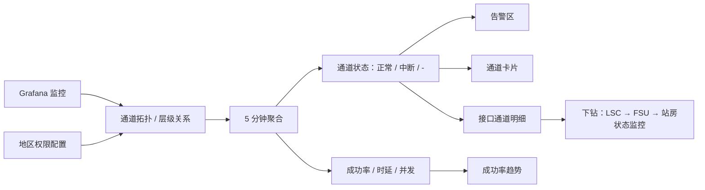
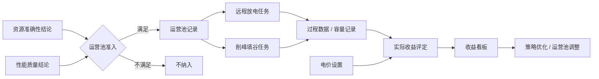

# 03 · 系统架构

## 3.1 架构定位

本仓库没有代码级架构，以下为**依据需求文档与原型反推的逻辑架构**，用于统一业务、产品、研发对系统边界的理解。它不是现有实现，也不代表最终技术选型。

- 架构视角：业务能力分层 + 数据流 + 部署约束。
- 核心思想：以站址/设备资源为主线，以"数据质量评定"为准入依据，以"远程放电/削峰填谷"为运营手段，以"收益稽核"为闭环终点。
- 双视角：省级视角（全局质量与趋势）与地市视角（本地站房与链路）。

## 3.2 总体逻辑架构

## 3.3 分层职责

| 层 | 职责 | 关键能力 | 主要输出 |
| --- | --- | --- | --- |
| 数据源层 | 提供资源、性能、过程、监控数据 | 动环 A 接口、综资/现场导入、协议库、Grafana | 原始资源/性能/链路数据 |
| 接入治理层 | 把异构数据变成可比较的统一模型 | 同步、导入校验、设备匹配、标准维护 | 统一资源模型、差异明细、标准信号量 |
| 评估分析层 | 回答"数据是否可信、设备是否可用、运营是否可行" | 7 类数据质量评定 + 4 类运行评估 + 电池健康 | 评定结论、异常清单、评估明细 |
| 运营执行层 | 把合格站址转化为运营动作与收益 | 运营池、放电、削峰填谷、收益、电价 | 任务、容量记录、收益结果 |
| 展示决策层 | 让省/地市/管理层看到全局与明细 | 看板、报表、导出 | 指标卡、趋势、明细、Excel |
| 支撑层 | 保证可控、可管、可追溯 | 权限、资产主数据、日志、导出任务 | 数据范围、审计记录、导出文件 |

## 3.4 核心业务闭环

闭环的关键点：

1. **整改回流**：综资/现场数据重新导入、动环重新同步后，评定结果自动重算，支持二次核验。
2. **准入联动**：运营池不是人工白名单，而是由资源准确性与性能质量结论自动推导。
3. **过程沉淀**：远程放电与削峰填谷的过程数据同时服务于遥调能力、动态数据、收益评定三类分析。
4. **效果反哺**：收益达成率与异常情况反过来影响运营池与策略配置。

## 3.5 典型数据流

### 3.5.1 资源准确性评定

关键规则：

- 对比来源至少选择 2 类（综资/动环/现场），首次进入必须先设置对比项。
- 某来源未导入 → 对应字段显示 `-`；所有来源均无设备 → ` / `。
- 动环每日凌晨自动更新；综资/现场导入后即时重算。
- 河北内网单次导出上限 1 万条。

### 3.5.2 性能质量评估

关键口径：

- 基础整治仅覆盖开关电源、锂电池、电表；完全整治覆盖五类设备。
- 实采判断取凌晨 0 点附近（默认前后 30 分钟，可配）的性能数据。
- 完全整治增加"信号量来源"：设备厂商字典或省公司标准。
- 协议变更后每日凌晨检测，提示是否清除结果并重新评估。

### 3.5.3 动环通道质量

关键规则：

- 最近 5 分钟有数据上来 → 正常；无采集 → `-`；有采集但无任何数据返回 → 中断。
- 成功率 = 今日成功次数 / 今日总次数 × 100%，保留 1 位小数，分母为 0 显示 `-`。
- 可用性 = 当日成功率 > 90% 且当前未离线；未调用过 → `-`。
- 省视角包含主通道卡片、实时状态图、成功率趋势；地市视角聚焦本地站房。

### 3.5.4 运营池与收益

## 3.6 部署与技术约束（需求推定）

> 以下为需求文档中的约束，**不是仓库中已验证的部署方案**。

| 维度 | 要求 | 影响 |
| --- | --- | --- |
| 操作系统 | 服务器支持 Linux 国产操作系统 | 需适配信创环境 |
| 数据库 | 支持国产化系统 | 不能假定 MySQL/Oracle 特性 |
| 浏览器 | IE9+，支持 HTML5 | 前端不能只用现代框架特性；需兼容性回归 |
| 可用性 | 7×24 稳定运行 | 需考虑任务调度、失败重试、监控 |
| 安全 | 集团二次安防扫描、通信安全规范 | 接口、文件上传、导出需安全加固 |
| 性能 | 1 万站房对比 20 分钟内完成 | 评估任务需异步化/批量处理 |
| 导出 | 分级时限（0.5s–5min） | 需导出任务队列与分片 |
| 分辨率 | 1280×720 至 2160×1440 | 响应式布局与表格固定列 |
| 部署形态 | 省中心部署，内网访问 | 隐藏"省"筛选；地市按权限可见 |

## 3.7 架构特点与风险

### 特点

1. **评估驱动运营**：运营池、放电、削峰填谷都建立在数据质量结论之上，避免"带病运营"。
2. **批流混合**：动环每日批同步、Excel 按需导入、性能实时拉取、通道 5 分钟聚合。
3. **规则可配置**：对比来源、协议标准、导出上限、采集时间窗均要求可配置。
4. **双视角设计**：省级看全局、地市看本地，同一套指标两种聚合粒度。
5. **闭环可核验**：整改后重新评估，收益按天核算，形成可追溯链路。

### 风险与缺口

| 风险 | 说明 | 建议 |
| --- | --- | --- |
| 需求细化不均 | 仅 4.1.1/4.1.2/4.1.7/4.3.1 较完整，4.2/4.4–4.12 多为占位 | 开发前补齐字段、状态、验收 |
| 口径冲突 | 运营池准入、字段命名、菜单归属多版本不一致 | 见 [05](05-数据模型与业务规则.md) 冲突清单 |
| 外部依赖重 | Grafana、动环、4A、EMOS、短信均不在本仓库 | 需接口联调计划与降级方案 |
| 原型可读性 | 页面主体为截图，交互细节无法从 HTML 提取 | 结合 `.rp` 源文件与需求文档 |
| 无代码基线 | 无法评估现有实现与需求的差距 | 需研发提供代码仓库/接口文档 |
| 合同不可检索 | PDF 为扫描件 | 需 OCR 或索取可检索版本 |
