# 04 · 功能模块详解

## 4.0 模块地图

```mermaid
flowchart TB
    ROOT["河北移动削峰填谷运营平台"]
    ROOT --> P1["平台入口 / 看板"]
    ROOT --> P2["数据质量管理"]
    ROOT --> P3["运行质量管理"]
    ROOT --> P4["协议管理"]
    ROOT --> P5["节费效果管理"]
    ROOT --> P6["远程放电"]
    ROOT --> P7["削峰填谷"]
    ROOT --> P8["运营池"]
    ROOT --> P9["虚拟集合 / 站址集合"]
    ROOT --> P10["工具箱"]
    ROOT --> P11["资源管理"]
    ROOT --> P12["系统管理"]

    P2 --> P2A["资源质量评估"]
    P2 --> P2B["性能质量评估"]
    P2 --> P2C["接口质量评估"]
    P3 --> P3A["机房运行评估"]
    P3 --> P3B["供备电能力评估"]
    P3 --> P3C["电表运行评估"]
    P3 --> P3D["空调运行评估"]
    P4 --> P4A["品牌管理"]
    P4 --> P4B["开关电源协议"]
    P4 --> P4C["锂电池协议"]
    P4 --> P4D["铅酸电池协议"]
    P4 --> P4E["空调协议"]
    P4 --> P4F["电表协议"]
    P5 --> P5A["收益测算"]
    P5 --> P5B["实际收益评定"]
    P5 --> P5C["收益看板"]
    P5 --> P5D["电价设置"]
    P6 --> P6A["放电管理"]
    P6 --> P6B["放电监控"]
    P6 --> P6C["放电历史"]
    P7 --> P7A["削峰填谷管理"]
    P7 --> P7B["削峰填谷监控"]
    P7 --> P7C["削峰填谷历史"]
    P10 --> P10A["批量遥调 / 批量调试"]
    P10 --> P10B["查询性能"]
    P10 --> P10C["查询告警"]
    P11 --> P11A["机房管理 / 查看设备"]
    P11 --> P11B["设备管理"]
    P12 --> P12A["用户管理"]
    P12 --> P12B["角色管理"]
    P12 --> P12C["平台日志"]
```



> 模块划分以 Axure 原型的 13 个一级节点为准；需求文档的 4.1–4.12 章节是另一种组织方式，两者并非一一对应，详见 [10-需求追踪矩阵.md](10-需求追踪矩阵.md)。

---

## 4.1 平台入口与看板

| 项 | 内容 |
| --- | --- |
| 职责 | 平台统一入口、全局指标展示、模块导航 |
| 对应页面 | 平台入口、欢迎页、看板管理、收益看板、运营看板 |
| 输入 | 各评估模块结论、运营任务与收益数据 |
| 输出 | 指标卡、趋势图、异常数量、跳转入口 |
| 关键内容 | 资源质量、性能质量、接口质量、运行状态、节费效果五类总览（拆分稿 4.1 首页） |
| 文档状态 | 仅有模块级描述，无字段级需求；原型有页面与截图 |

**看板设计意图**：让管理层快速回答四个问题——资源是否准确、设备是否可用、运营是否在跑、收益是否达成。

---

## 4.2 数据质量管理

### 4.2.1 资源质量评估（资源准确性评定）

> 需求文档 4.1.1；原型页面 `资源质量评估.html`；这是全仓库细化程度最高的模块。

**职责**：对动环、综资、现场三方数据进行一致性评定，识别"账实不符"、来源缺失、属性冲突，输出差异清单支撑线下整改与二次核验。

**使用角色**：超级管理员、资源数据维护人员、资源核查人员、整改责任人员、管理查看人员。

**页面结构**

```text
查询筛选区
  ├─ 地区（地市/区县，支持多选、级联）
  ├─ 所属动环（河北隐藏）
  ├─ 虚拟集合（多选）
  ├─ 评估结论（一致/不一致/-//）
  ├─ 站房名称（模糊）
  └─ 站房ID（单个/批量，支持中英文逗号、空格、换行）
操作区
  ├─ 设置对比项（默认仅超级管理员）
  ├─ 刷新数据
  ├─ 导入资源数据（综资/现场）
  └─ 导出
结果区
  ├─ 资源评估汇总（站房维度）
  ├─ 站房设备数量对比
  ├─ 开关电源信息对比
  ├─ 锂电池信息对比
  ├─ 铅酸电池组信息对比
  ├─ 空调信息对比
  └─ 电表信息对比
浮窗详情区（超长字段、站房/设备补充信息）
```

**对比范围**：开关电源、锂电池、铅酸电池组、空调、电表；FSU 仅导入并展示厂商，不参与评估。对比内容包含**数量对比**与**属性对比**。

**数据来源与更新频率**

| 来源 | 获取方式 | 更新频率 |
| --- | --- | --- |
| 动环 | A 接口调用 | 每天凌晨自动更新 |
| 综资 | Excel 人工导入 | 按需 |
| 现场 | Excel 人工导入 | 按需 |

**关联规则**

- FSU：通过**机房 ID** 关联。
- 其他设备：通过**设备编码**关联。
- 模板中具备关键字段即可导入并参与评估；导入后自动触发匹配与评定重算。

**关键字段（站房汇总）**：站房名称、站房属性、评估结论、数量对比（5 类设备）、信息对比（5 类设备）、所属虚拟集合、更新时间、地市、区县。

**结论规则**

| 结论 | 含义 |
| --- | --- |
| 一致 | 五类设备数量与信息均一致 |
| 不一致 | 任一设备数量或信息不一致 |
| `-` | 数据源未完全导入或暂未评估 |
| `/` | 所有来源下所有设备均无资源，不评估 |

**数量评估结论**（按对比来源组合）：

- 动环 vs 综资：综资少于动环 / 综资多于动环 / 数据一致 / `-` / `/`
- 动环 vs 现场：动环少于现场 / 动环多于现场 / 数据一致 / `-` / `/`
- 现场 vs 综资：综资少于现场 / 综资多于现场 / 数据一致 / `-` / `/`
- 三方对比：数据不一致 / 数据一致 / `-` / `/`

**差异口径**：差异 = 现场数量 − 动环数量。

**导入模板关键字段**

| 设备 | 关键字段 |
| --- | --- |
| FSU | 站房ID、FSU厂家 |
| 开关电源 | 所属机房、设备编码、设备型号、系统编号、整流模块总数、模块型号、设备名称、动环名称 |
| 锂电池 | 所属机房、设备编码、设备厂家、设备型号、额定容量(AH)、组内单体总数、设备名称、动环机房名称、设备品牌、所属电源设备 |
| 铅酸电池组 | 所属机房、设备编码、设备厂家、设备型号、设备名称等 |
| 空调 | 所属机房、设备编码、设备厂家、设备型号、设备名称 |
| 电表 | 低压配电设备 + 电表字段（含电表回路数） |

**导出**

- 按当前查询条件、当前页签、列表字段顺序导出 `.xlsx`。
- 设备名称、站房名称后补充对应 ID。
- 河北内网单次上限 **10000 条**，超出提示"导出的数据量不得超过1w条，请检查"。
- 7 个导出模板见 `导出模板列头.xlsx`。

**验收要点（节选）**

1. 选择"动环 + 现场"后，页面只展示对应来源字段，结论基于所选来源生成。
2. 站房 ID 批量查询支持中英文逗号/空格/换行，且不返回无关数据。
3. 某来源未导入显示 `-`，所有来源无设备显示 `/`，不得混用。
4. 导入缺字段/格式错误/无法匹配时给出失败原因与异常明细。
5. 导出字段、顺序、页签与页面一致，并补充辅助 ID。
6. "设置对比项"按钮默认仅超级管理员可用。

**状态**：需求详细（文档 4.1.1 + 调整稿 + 验收表）；原型截图为汇总表样式；确认表标记"已完成原型"。

**已知差异**：需求写"评估结论"筛选包含"一致/不一致/-//"，原型筛选项为"评估结论"；原型汇总表头还包括"站房设备数量对比"等页签，与文档"站房汇总/数量评估/设备评估"三类不完全一致，需以最终设计为准。

### 4.2.2 性能质量评估（信号量通道合理性评定）

> 需求文档 4.1.2；原型 `性能质量评估.html`。

**职责**：通过全量静态数据扫描，判断设备性能数据是否"取得到、不失真"，并按基础整治/完全整治输出结论。

**设备与整治范围**

| 设备 | 基础整治 | 完全整治 |
| --- | --- | --- |
| 开关电源 | 支持 | 支持 |
| 锂电池 | 支持 | 支持 |
| 电表 | 支持 | 支持 |
| 铅酸电池组 | 不支持 | 支持 |
| 空调 | 不支持 | 支持 |

**页面结构**

- 查询：地区（省/地市/区县，内网隐藏省）、所属动环（全部/东信/卓望）、虚拟集合、评估结论、站房名称、站房 ID、评估时间（更多条件）。
- 操作：开启评估、拉取校验标准、导出。
- 结果：站房汇总 + 开关电源/锂电池/铅酸电池/空调/电表五个设备页签 + 信号量详情页。

**核心指标**

| 指标 | 说明 |
| --- | --- |
| 信号量个数 | 标准要求应采集的信号量数量 |
| 实采信号量个数 | 实际采集到的数量 |
| 缺失信号量个数 | 标准中存在但未采集 |
| 失真信号量个数 | 采集到但值不合理 |
| 是否合格 | 合格 / 不合格 / `-` / `/` |

- 基础整治：合格 = 数据有且不失真；不合格 = 缺失或失真。
- 完全整治：在信号量个数前增加"信号量来源"，取值为"设备厂商"或"标准"。
- 实采判断取凌晨 0 点附近（默认前后 30 分钟，可配置）的性能数据。
- 设备页签展示：站房名称、设备名称、FSU 厂家、设备厂商、型号、监控模块型号/软件版本号（仅开关电源）、基础/完全整治明细、更新时间、所属动环/虚拟集合、省市县。

**开启评估规则**

- 弹窗提示"已选择 N 个设备，其中 M 个无评估标准，无法评估，请联系管理维护。是否评估余下的 N−M 个？"
- 支持下载无法评估设备清单。
- 全部无标准时直接提示"选择的设备无校验标准，请维护标准；若已维护请重新拉取"。
- 评估在后台执行，右上角显示进度。

**拉取校验标准**：标准缺失或更新后重新拉取，拉取过程显示进度。

**协议变更检测**：协议库变更后每日凌晨检测，提示"检测到#厂家#的#型号#设备已更新校验标准，是否清除校验结果并重新评估"。

**导出**：字段同列表，设备/站房名称后补 ID；超过 50 万条时分 sheet。

**状态**：需求详细；原型有页面；确认表"已完成原型"，但"是否开发完成需要确认"。

### 4.2.3 接口质量评估（动环通道质量评定）

> 需求文档 4.1.7；原型 `接口质量评估.html`。

**职责**：面向动环平台接口质量的统一监控、分析与运维定位，提供省视角与地市视角。

**核心能力**

| 区域 | 内容 |
| --- | --- |
| 告警信息区 | 主通道/LSC/FSU 中断提示，省视角精确到通道，地市视角汇总"当前有 xx 站房离线"；支持查看详情、展开全部 |
| 头部信息区 | 监控范围（纳管站房/全部站房，需权限）、最近更新时间、刷新间隔（默认 5 分钟，不可设置） |
| 通道卡片 | 按链路显示主通道、LSC 子通道、FSU；状态正常/中断/`-`；显示延迟、线程、并发、成功率 |
| 主通道实时状态 | 当日 0 点至今、5 分钟聚合的状态图，展示中断次数与累计时长，浮窗显示原因 |
| 成功率趋势 | 主通道当日成功率按 5 分钟聚合，展示平均/峰值/谷值/最新 |
| 接口通道明细 | 东信/卓望分页签，LSC 厂商+地市维度，可下钻 FSU 站房 |

**链路模型**

- 东信（三级）：主通道 → LSC 子通道 → FSU。
- 卓望（二级）：主通道 → FSU。
- 通过后台预设链路关系自动识别层级，支持多链路并发监控。

**关键口径**

| 指标 | 计算规则 |
| --- | --- |
| 当前状态 | 最近 5 分钟有数据 → 正常；无采集 → `-`；有采集但无任何数据返回 → 中断 |
| 离线持续时长 | 当前时刻 − 最近一次离线开始时间；在线显示 `-` |
| 当日调用成功率 | 今日成功次数 / 今日总次数 × 100%，1 位小数，分母 0 → `-` |
| 当日离线次数 | 当日 0 点至当前累计，恢复在线仍保留 |
| 并发情况 | 当前调用中的 FSU 通道数 / 接入 FSU 通道总数 |
| 通道可用性 | 当日成功率 > 90% 且当前未离线 → 可用；否则不可用；未调用过 → `-` |

**依赖**：Grafana 的接口监控过程信息、通道拓扑配置、地区权限配置。

**状态**：需求详细；原型呈现为"总接口质量评估、1 小时/24 小时成功率"指标卡与成功率趋势图，较需求文档的通道卡片/状态图更简，说明原型可能早于最新需求。

---

## 4.3 设备数据质量评定专项

### 4.3.1 设备映射关系评定

> 需求文档 4.1.3；原型未单独建页（确认表建议放在性能质量评估或资源管理）。

**职责**：评估开关电源与电池、电表与用电设备之间的映射关系是否完整。

**依赖**

- 资源纳管：站址及站下开关电源、电池、电表、空调等设备已接入。
- 映射维护：平台需具备开关电源-电池、电表-用电设备的映射管理能力；映射后自动刷新评估结果。

**页面**

- 查询：地区、虚拟集合、映射完整性（映射完整/映射不完整/`-`）、站房名称、站房 ID。
- 导出：字段同列表，设备/站房名称后补 ID，超过 50 万条分 sheet。
- Tab 1 开关电源映射：站房名称、开关电源名称、映射完整性、下挂锂电池数、下挂铅酸电池组数、下挂智能锂电池数、未下挂电池数、虚拟集合、省/地市/区县；下挂数量支持下钻。
- Tab 2 电表映射：站房名称、电表名称、映射完整性、已映射设备数、未映射设备数；数量支持下钻。

**状态**：需求大纲级；无独立原型页；确认表"已完成原型"但页面归属待定。

### 4.3.2 设备协议库管理 / 协议管理

> 需求文档 4.1.4；原型 `协议管理.html` 及品牌/5 类设备协议页。

**职责**：维护在网电源、电池、电表、空调的厂商型号及其信号量支持定义，并维护设备适用的 FSU 协议，为性能质量评估提供校验标准。

**品牌管理**

- 覆盖 7 类：开关电源、锂电池、铅酸电池、空调、电表、FSU、合路器。
- 开关电源额外维护监控模块型号、软件版本号。
- 品牌管理是协议维护的前置：未维护品牌型号，无法添加协议。

**设备协议**

- 每类设备协议包含：设备本体协议 + 适用 FSU 协议。
- 支持单条新增、批量导入、查询、编辑。
- 协议下定义标准信号量（性能质量评估的主要依据）。
- 锂电池/铅酸电池/空调/电表协议字段相同，合并说明；开关电源单独说明。

**状态**：需求较完整；原型有 6 个页面（品牌管理 + 5 类设备）；确认表"已完成原型"、要求提供原型链接，清明后 7 天。

### 4.3.3 遥调能力满足度评定

> 需求文档 4.1.5；原型未单独建页（确认表建议复用远程放电历史）。

**职责**：评估站房开关电源是否具备远程调控浮充/均充能力，以及遥调深度是否满足要求。

**依赖**：远程放电、削峰填谷执行记录、算法分析结果。从未参与遥调的设备不纳入成功/失败统计，结论显示 `-`。

**页面**

- 查询：地区、虚拟集合、遥调能力（遥调成功/遥调失败/遥调深度不足/`-`）、站房名称、站房 ID。
- 表单：站房名称、开关电源名称、远程放电时间、遥调能力、遥调深度、虚拟集合、省/地市/区县。
- 多条记录时按规则/算法选取最优一条。

**状态**：需求大纲级；无独立原型；确认表"已完成原型"，计划 4.15。

### 4.3.4 动态数据合理性评定

> 需求文档 4.1.6；原型未单独建页。

**职责**：利用放电过程数据评估开关电源信号量是否失真、数据间逻辑关系是否合理。

**评估项**（8 类）：

1. 直流电压失真
2. 负载电流失真
3. 组电流失真
4. 模块电流失真
5. 电池数据失真
6. 负载电流变化异常
7. 负载电流与模块电流不一致
8. 负载与电池放电电流不一致

**页面**

- 查询：地区、虚拟集合、站房名称、站房 ID。
- 表单：站房名称、开关电源名称 + 8 类异常；每项支持下钻查看原因。
- 多次放电时选取最优结果作为最终结论。
- 导出规则同其他模块（50 万条分 sheet）。

**状态**：需求大纲级；无独立原型；确认表"已完成原型"，需协调演示广东准生产平台。

---

## 4.4 运行质量管理

> 需求文档第 4 章仅列章节；拆分稿 4.3.1–4.3.4 给出功能描述；原型仅有"供备电能力评估"页。

| 子模块 | 职责 | 关键指标 | 状态 |
| --- | --- | --- | --- |
| 机房运行评估 | 分析机房电源运行状态与负荷 | 负荷平均值、负荷变化率、停电次数、退服次数、运行标签 | 大纲，无原型 |
| 供备电能力评估 | 判断供电/备电能力是否满足业务 | 交直流转换效率、开关电源参数合理性、电池可放电时长、容量衰减、线损、漏接监控、单体异常 | 有原型页，需求待细化 |
| 电表运行评估 | 判断电表采集准确性与分路关系完整性 | 分路挂接完整性、用电量偏差、采集异常 | 大纲，无原型 |
| 空调运行评估 | 分析空调运行质量与制冷效率 | 温度、运行状态、压缩机占空比、PUE、分区间统计 | 大纲，无原型 |

---

## 4.5 电池健康度智能评估

| 子模块 | 内容 | 优先级 | 状态 |
| --- | --- | --- | --- |
| 电池能力评估（河北本地运维特点） | 结合本地运维经验评估电池能力 | 中 | 已收集，需求未展开 |
| 电池衰减情况分析 | 定期记录容量、充饱后初期电压等性能数据，描绘电池生命曲线，支持衰减分析 | 高 | 使用广东经验；"李岩 AI"相关；需求文档 4.2 为空 |

**依赖**：远程放电历史、容量分析结果、电池基础档案。

---

## 4.6 能量运营与运营池

### 4.6.1 运营池

> 需求文档 4.3.1；草案建议作为 4.13；原型 `运营池.html`（挂在削峰填谷菜单下）。

**职责**：统一管理站址的运营准入状态与最近一次容量分析结果，为后续运营分析和人工维护提供依据。

**准入规则（两版表述）**

| 来源 | 条件 |
| --- | --- |
| 需求文档 4.3.1 | 数据质量评定为"资源准确" **且** 开关电源性能数据的**基础整治**评定为"合格" |
| 需求草案 4.13 | 数据质量评定为"资源准确" **且** 性能质量评定为"合格" |

> 两版差异在于"基础整治合格"还是"性能质量合格"（完全整治可能也需合格）。需产品确认，见 [05](05-数据模型与业务规则.md#58-已知冲突与待确认)。

**查询条件（草案）**：地市、站房名称、站房 ID（批量）、当前运营状态（已运营/未运营/`-`）、运营类型。

**列表字段（草案）**：站房名称、开关电源名称、实际可放电时长、当前运营状态、运营类型、额定容量、最近一次运营时间、起始容量、结束时容量、更新时间。

**原型实际列**：站房名称、开关电源名称、实际可放电时长(H)（业务提供）、实时运营状态、运营类型、额定容量、最近一次运营前剩余容量、最近一次运营结束剩余容量、操作。

**页面逻辑**

1. 首次打开展示权限范围内全部站址。
2. 根据最新数据质量 + 性能质量结果自动判断准入。
3. 仅展示最近一次有效容量/运营结果。
4. 实际可放电时长支持单条编辑，保存后刷新更新时间。
5. 保存失败提示原因并保留编辑前数据。

**导入/导出**

- 导入用于批量维护实际可放电时长、运营类型等允许字段；导入后刷新列表与更新时间；失败返回明细。
- 导出当前查询结果，字段同列表。

**空值规则**

| 场景 | 显示 |
| --- | --- |
| 无容量分析结果 | 起始/结束容量、最近运营时间 `-` |
| 无运营类型配置 | 运营类型 `-` |
| 未满足准入 | 当前运营状态"未运营"或按业务约定 |
| 数据质量/性能质量未产出 | 当前运营状态 `-` |
| 开关电源信息缺失 | 开关电源名称 `-` |

**状态**：需求详细（4.3.1 + 草案）；原型有页面；存在字段/准入/菜单归属冲突。

### 4.6.2 能量运营监测

- 目标：基于安全运营理念，实现全程告警数据、异常状态、循环轮次、任务达成率监测。
- 状态：确认表"已实现"，需开通 V3 运营监测模块；需求文档章节为空。
- 依赖：远程放电/削峰填谷任务、告警、4A 权限。

### 4.6.3 能量运营分析

- 目标：
  1. 站址维度交流侧/直流侧转换率测评；
  2. 站址维度每日循环任务达成情况、收益后评估；
  3. 电费单据用电量与运营数据电量对比评估。
- 状态：第 1、2 项已完成，第 3 项未启动；确认表要求开通 V3 运营效益模块。
- 需求文档章节为空。

---

## 4.7 节费效果管理

| 子模块 | 职责 | 关键点 | 状态 |
| --- | --- | --- | --- |
| 收益测算 | 运营前预估节费收益 | 按单/多站房、日/月/年，结合策略、电价、负荷、可调能力 | 大纲；原型有页面 |
| 实际收益评定 | 运营后核算真实收益并对比预估 | 按天计算，收益达成率、偏差原因、站房级明细 | 大纲；原型有页面 |
| 收益看板 | 展示收益规模/趋势/策略效果 | 运营次数、收益总额、达成率、地市/策略分布、时间趋势 | 大纲；原型有页面 |
| 电价设置 | 维护电价参数 | 按地区、时间段、电价类型新增/编辑/启停/查询 | 大纲；原型有页面 |

**共同依赖**：运营任务记录、用电数据、电价规则、站址/设备档案。

---

## 4.8 远程放电

| 子模块 | 职责 | 关键能力 |
| --- | --- | --- |
| 远程放电管理 | 筛选可放电对象并配置任务 | 地区/站房/虚拟集合/设备状态筛选；放电策略、时长、保护阈值、执行时间 |
| 远程放电监控 | 实时查看任务执行 | 任务状态、站房告警、实时性能、电压电流曲线、进度、异常提示 |
| 远程放电历史 | 沉淀全过程数据 | 任务时间、对象、关键参数、平台日志、结果、异常；查询/导出 |

**本期变化**

- 保留二期功能，改为**电源维度**。
- 保留停电告警、机房温度高告警、起火预警弹窗；短信通知保留，需与 EMOS 打通（待总公司提供短信模板）。
- 页面呈现改为动环编码。
- 只有特定账号（陈晨总）可见；清明后 7 天地市可使用，需演示。

**下游价值**：遥调能力评定、动态数据评定、电池衰减分析、实际收益评定的数据来源。

---

## 4.9 削峰填谷

| 子模块 | 职责 | 关键能力 |
| --- | --- | --- |
| 削峰填谷管理 | 筛选适合参与的机房并配置策略 | 地区/站房/虚拟集合/可运营状态筛选；执行策略、运行时间、目标功率、保护参数、执行计划 |
| 削峰填谷监控 | 实时掌握执行过程与风险 | 任务状态、告警、实时性能、功率变化、执行进度、异常 |
| 削峰填谷历史 | 保存执行记录与过程数据 | 任务时间、参与站房、策略、关键性能、平台日志、结果；查询/导出 |

**关系**：运营池在原型中挂在该菜单下；削峰填谷过程数据同时供遥调、动态数据、收益评定使用。

---

## 4.10 资源管理

| 子模块 | 职责 | 关键能力 |
| --- | --- | --- |
| 虚拟集合 / 站址集合 | 按业务需要划分站址/设备范围 | 新增、编辑、删除、查询、成员维护；作为各页面筛选条件 |
| 机房管理 | 维护纳管站房基础信息 | 列表、查询、详情、导入、导出、字段查看；按地区/名称/ID/集合检索 |
| 查看设备 | 查看站房下设备 | 设备列表、详情、类型切换 |
| 设备管理 | 维护开关电源/锂电池/铅酸电池/空调/电表 | 列表、查询、详情、导入、导出；批量映射 |

**映射维护**：资源管理中的"站房管理-映射关系"与"设备管理-批量映射"是设备映射评定的前置能力。

---

## 4.11 工具箱

| 子模块 | 职责 | 关键点 |
| --- | --- | --- |
| 批量遥调 / 批量调试 | 对多个设备发起远程调控 | 选择多个开关电源、配置参数、提交任务、展示结果/失败原因/日志 |
| 查询性能 | 按需获取实时/近实时性能 | 选择站房、设备类型、设备；单次查询 ≥ 500 条；结果查看/导出 |
| 查询告警 | 按需获取告警 | 按地区、站房、设备、级别、时间查询；展示名称、发生/恢复时间、状态、设备 |

---

## 4.12 系统管理与导出管理

| 子模块 | 职责 | 关键能力 |
| --- | --- | --- |
| 用户管理 | 维护登录用户与账号状态 | 列表/详情；用户名、姓名、联系方式、状态、角色、创建时间；新增/编辑/删除/启停/分配角色 |
| 角色管理 | 维护角色与权限 | 新增/编辑/删除；菜单权限、按钮权限、地区数据权限 |
| 平台日志 | 记录操作与系统动作 | 操作时间、操作人、页面、动作、对象、结果；查询/过滤/导出 |
| 导出管理（拆分稿 4.11） | 集中管理大数据导出任务 | 任务名称、来源模块、创建人、时间、状态、文件大小、下载；查询/下载/过期清理 |

---

## 4.13 模块状态总表

| 模块 | 需求细化 | 原型 | 确认表进度 | 备注 |
| --- | --- | --- | --- | --- |
| 资源质量评估 | 详细 | 有 | 已完成原型 | 全仓库最完整 |
| 性能质量评估 | 详细 | 有 | 已完成原型 | 开发完成待确认 |
| 接口质量评估 | 详细 | 有（较简） | 完成原型绘制 | 原型早于最新需求 |
| 设备映射评定 | 大纲 | 无独立页 | 已完成原型 | 页面归属待定 |
| 协议库管理 | 较详细 | 有 6 页 | 已完成原型 | 清明后 7 天 |
| 遥调能力评定 | 大纲 | 无独立页 | 已完成原型 | 4.15 |
| 动态数据评定 | 大纲 | 无独立页 | 已完成原型 | 需演示广东平台 |
| 运行质量管理 | 大纲 | 仅供备电 | 未明确 | 需补需求 |
| 电池健康度 | 空/大纲 | 无 | 部分已收集 | AI 相关 |
| 运营池 | 详细 | 有 | 部分已实现 | 多版本冲突 |
| 能量运营监测/分析 | 空 | 无 | 部分已实现 | 依赖 V3 模块 |
| 节费效果 | 大纲 | 有 4 页 | 已实现部分 | 需求待细化 |
| 远程放电 | 保留二期 | 有 3 页 | 保留 | 改电源维度 |
| 削峰填谷 | 大纲 | 有 3 页 | — | 需求待细化 |
| 资源管理 | 大纲 | 有 4 页 | — | 映射能力关键 |
| 工具箱 | 大纲 | 有 3 页 | — | — |
| 系统管理 | 大纲 | 有 3 页 | — | 权限模型关键 |
