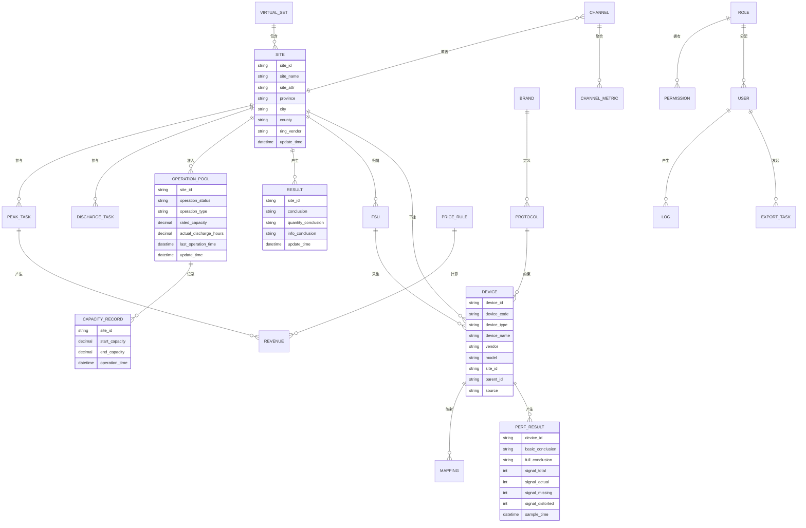

# 05 · 数据模型与业务规则

## 5.1 说明

仓库中没有数据库设计，本章是依据需求文档、导入模板、导出列头与原型界面抽象出的**概念模型**，用于统一术语和后续表结构设计。实体名与字段名不是最终数据库命名。

建模主线：

```text
虚拟集合 → 站址/机房 → 设备（FSU / 开关电源 / 锂电池 / 铅酸电池组 / 空调 / 电表）
                                 ├─ 设备映射（电源-电池、电表-用电设备）
                                 ├─ 协议/品牌/信号量标准
                                 └─ 评估结果（资源 / 性能 / 映射 / 遥调 / 动态）
站址 → 运营池 → 容量记录 / 运营任务（放电、削峰填谷）→ 收益
用户 → 角色 → 页面/按钮/数据权限
```

## 5.2 实体清单

| 实体 | 说明 | 主要来源 |
| --- | --- | --- |
| 虚拟集合 | 自定义站址/设备分组 | 资源管理 |
| 站址/站房 | 机房基础档案，含省/地市/区县、站房属性 | 动环、资源管理 |
| FSU | 现场监控单元，按机房 ID 关联 | 综资/现场导入 |
| 设备 | 开关电源、锂电池、铅酸电池组、空调、电表 | 动环、综资/现场导入 |
| 品牌/型号 | 设备品牌、型号、监控模块型号、软件版本 | 协议管理 |
| 协议 | 某品牌型号支持的信号量标准 + 适用 FSU 协议 | 协议管理 |
| 资源评定结果 | 站房级/设备级的数量与属性一致性结论 | 资源质量评估 |
| 性能评定结果 | 设备级基础/完全整治结论与信号量统计 | 性能质量评估 |
| 映射关系 | 开关电源-电池、电表-用电设备 | 资源管理、设备映射评定 |
| 遥调评定结果 | 开关电源遥调成功/失败/深度不足 | 遥调能力评定 |
| 动态数据评定结果 | 8 类动态数据异常 | 动态数据评定 |
| 通道/通道指标 | 主通道、LSC、FSU 及 5 分钟聚合指标 | 接口质量评估 |
| 运营池记录 | 站址运营准入状态与容量记录 | 运营池 |
| 容量记录 | 起始容量、结束容量、运营时间 | 容量分析/运营池 |
| 放电任务 | 远程放电任务及过程数据 | 远程放电 |
| 削峰填谷任务 | 削峰填谷任务及过程数据 | 削峰填谷 |
| 电价规则 | 地区/时段/电价类型 | 电价设置 |
| 收益结果 | 测算收益、实际收益、达成率 | 收益测算/评定 |
| 用户/角色/权限 | 账号、角色、页面/按钮/数据权限 | 系统管理 |
| 导出任务 | 导出文件、状态、下载入口 | 导出管理 |
| 平台日志 | 操作审计 | 平台日志 |

## 5.3 ER 图（概念）



## 5.4 核心实体字段

### 5.4.1 站址/站房（Site）

| 字段 | 类型建议 | 说明 | 来源 |
| --- | --- | --- | --- |
| site_id | string | 站房 ID，唯一 | 动环 |
| site_name | string(200) | 站房名称 | 动环 |
| site_attr | string(100) | 站房属性（如传输机房、接入机房、空调机房） | 动环 |
| province/city/county | string | 省/地市/区县 | 资源档案 |
| ring_vendor | string(10) | 所属动环（东信/卓望），河北隐藏 | 资源档案 |
| virtual_sets | string | 所属虚拟集合，多个逗号分隔 | 资源管理 |
| update_time | datetime | 最近更新时间 | 系统 |

### 5.4.2 设备（Device）

| 字段 | 说明 |
| --- | --- |
| device_id | 设备 ID |
| device_code | 设备编码，跨来源关联键（FSU 除外） |
| device_type | 开关电源 / 锂电池 / 铅酸电池组 / 空调 / 电表 / FSU / 合路器 |
| device_name | 设备名称 |
| vendor / model | 厂家 / 型号 |
| monitor_model / software_version | 开关电源专有：监控模块型号 / 软件版本 |
| site_id | 所属站房 |
| fsu_id | 所属 FSU（按机房 ID 关联） |
| parent_power_id | 电池关联的开关电源 |
| meter_loop | 电表回路（第 1–4 路/单路） |
| rated_capacity | 额定容量（锂电池 AH） |
| cell_count | 组内单体总数 |
| source | 动环 / 综资 / 现场 |

### 5.4.3 评估结果

| 字段 | 说明 |
| --- | --- |
| conclusion | 整体结论：一致 / 不一致 / `-` / `/` |
| quantity_conclusion | 数量对比结论 |
| info_conclusion | 信息对比结论 |
| device_analysis | 各设备类型分析结论（如"综资少于动环"） |
| diff_value | 数量差异 = 现场数量 − 动环数量 |
| sample_time / update_time | 评估时间 / 更新时间 |

### 5.4.4 性能结果

| 字段 | 说明 |
| --- | --- |
| basic_conclusion | 基础整治：合格 / 不合格 / `-` / `/` |
| full_conclusion | 完全整治：合格 / 不合格 / `-` / `/` |
| signal_source | 信号量来源：设备厂商 / 标准（仅完全整治） |
| signal_total / actual / missing / distorted | 信号量统计 |
| sample_time | 性能采样时间（凌晨 0 点附近） |

### 5.4.5 运营池记录

| 字段（草案） | 说明 | 原型对应 |
| --- | --- | --- |
| site_id / site_name | 站址 | 站房名称 |
| power_name | 开关电源名称 | 开关电源名称 |
| actual_discharge_hours | 实际可放电时长，可编辑 | 实际可放电时长(H)（业务提供） |
| operation_status | 当前/实时运营状态 | 实时运营状态 |
| operation_type | 运营类型 | 运营类型 |
| rated_capacity | 额定容量 | 额定容量 |
| last_operation_time | 最近一次运营时间 | 原型未显示 |
| start_capacity | 起始容量 | 最近一次运营前剩余容量 |
| end_capacity | 结束时容量 | 最近一次运营结束剩余容量 |
| update_time | 更新时间 | 原型未显示 |

### 5.4.6 协议与标准

| 字段 | 说明 |
| --- | --- |
| brand / model | 品牌 / 型号 |
| device_type | 7 类设备 |
| monitor_model / software_version | 开关电源 |
| protocol_id | 协议 |
| signal_list | 标准信号量集合（名称、单位、必采标识） |
| signal_source | 设备厂商 / 省公司标准 |
| fsu_protocol | 适用 FSU 协议 |

### 5.4.7 权限

| 实体 | 关键字段 |
| --- | --- |
| 用户 | user_id、用户名、姓名、联系方式、状态、角色、创建时间 |
| 角色 | role_id、角色名、菜单权限、按钮权限、地区数据权限 |
| 数据权限 | 省 / 地市 / 区县范围 |
| 按钮权限 | 设置对比项、导入资源、导出、开启评估、拉取校验标准等 |

## 5.5 枚举与状态字典

| 枚举 | 取值 | 使用场景 |
| --- | --- | --- |
| 评估结论 | 一致 / 不一致 / `-` / `/` | 资源、性能、映射 |
| 数量分析结论 | 综资少于动环、综资多于动环、动环少于现场、动环多于现场、综资少于现场、综资多于现场、数据一致、数据不一致、`-`、`/` | 资源数量评估 |
| 性能结论 | 合格 / 不合格 / `-` / `/` | 基础/完全整治 |
| 映射完整性 | 映射完整 / 映射不完整 / `-` | 设备映射 |
| 遥调能力 | 遥调成功 / 遥调失败 / 遥调深度不足 / `-` | 遥调评定 |
| 接口状态 | 正常 / 中断 / `-` | 通道/站房 |
| 通道可用性 | 可用 / 不可用 / `-` | 接口明细 |
| 运营状态 | 已运营 / 未运营 / `-`（原型还出现"运营前测试"） | 运营池 |
| 运营类型 | 常态化运营 / 削峰填谷 / …（以业务配置为准） | 运营池 |
| 数据来源 | 动环 / 综资 / 现场 | 资源对比 |
| 设备类型 | 开关电源 / 锂电池 / 铅酸电池组 / 空调 / 电表 / FSU / 合路器 | 全局 |
| 信号量来源 | 设备厂商 / 标准 | 完全整治 |
| 监控范围 | 纳管站房 / 全部站房 | 接口质量 |
| 视图 | 省视角 / 地市视角 | 接口质量 |

## 5.6 关联规则

| 对象 | 关联键 | 说明 |
| --- | --- | --- |
| FSU | 机房 ID | FSU 不参与资源评估，仅展示厂商 |
| 其他设备 | 设备编码 | 综资/现场数据与动环数据关联 |
| 电池 → 开关电源 | 所属电源设备 / parent_power_id | 映射评估基础 |
| 电表 → 用电设备 | 电表回路 / 分路关系 | 映射评估基础 |
| 站址 → 虚拟集合 | 多对多 | 虚拟集合可作为全局筛选条件 |
| 站址 → 运营池 | site_id | 准入结论按站址计算 |

## 5.7 业务规则

### 5.7.1 资源准确性

1. 首次进入必须先设置对比项，至少选 2 类来源；选择 2 类时只允许这 2 类，选择 3 类时固定三类。
2. 未导入来源 → 字段 `-`；所有来源无设备 → `/`；不满足条件或无结果 → `-`。
3. 站房汇总结论：五类设备数量与信息全部一致 → 一致；任一不一致 → 不一致。
4. 数据更新后自动重算：动环同步、综资导入、现场导入均触发。
5. 导出超过 1 万条（河北内网）拒绝并提示。

### 5.7.2 性能质量

1. 基础整治仅开关电源、锂电池、电表；完全整治覆盖五类。
2. 实采信号量取凌晨 0 点附近数据，默认前后 30 分钟，可配置。
3. 完全整治需展示信号量来源（设备厂商/标准）。
4. 协议变更每日凌晨检测，提示清除结果并重评。
5. 无标准设备不评估；全部无标准时直接提示。

### 5.7.3 接口质量

1. 5 分钟为一个采集间隔。
2. 有数据 → 正常；无采集 → `-`；有采集无返回 → 中断。
3. 成功率保留 1 位小数，分母为 0 → `-`。
4. 可用性：成功率 > 90% 且未离线；未调用过 → `-`。
5. 省视角与地市视角的卡片、趋势、明细范围不同。

### 5.7.4 运营池

1. 准入由数据质量 + 性能质量自动判断，不人工指定。
2. 仅展示最近一次有效容量/运营结果。
3. 实际可放电时长仅支持单条编辑，保存后刷新更新时间。
4. 保存失败保留编辑前数据并提示原因。
5. 导入支持批量维护，失败返回明细。
6. 空值按 4.6.1 规则显示 `-`。

### 5.7.5 通用展示与数据规范

| 规则 | 要求 |
| --- | --- |
| 下拉默认 | 初始"全部" |
| 数值 | 页面/导出保留 2 位小数 |
| 单位 | 字段名后加"（单位）"，如负载电流（A） |
| 表格 | 支持固定列、自定义列、账户级个性化配置（存服务器） |
| 长文本 | 站房/设备名称不显示 ID，浮窗查看并支持一键复制名称和 ID |
| 分页 | 20/60/80/200/500 条每页 |
| 批量 ID | 支持中英文逗号、空格、换行分隔 |
| 防重复 | 除查询外，操作按钮需防瞬间多次点击 |
| 数据权限 | 无某地市权限时不可见该地市名称 |
| 单位体系 | 电压 V、电流 A、功率 kW、收益 元 |

## 5.8 已知冲突与待确认

| 编号 | 冲突/缺口 | 影响 | 建议 |
| --- | --- | --- | --- |
| C1 | 运营池准入：4.3.1 要求"开关电源基础整治合格"，草案要求"性能质量合格" | 准入结果可能不同 | 产品确认以哪条为准 |
| C2 | 运营池字段：草案"起始/结束容量、更新时间" vs 原型"运营前/结束剩余容量"，原型无更新时间列 | 页面与接口字段不一致 | 统一字段字典 |
| C3 | 运营池菜单位置：原型在"削峰填谷"下，需求在"能量运营效果稽核"下，草案建议 4.13 | 导航与权限归属不清 | 确认一级菜单 |
| C4 | 4.3.1 查询条件出现"遥调能力"，与运营池业务不匹配（疑似从 4.1.5 复制） | 需求歧义 | 删除或改为运营状态 |
| C5 | "站址ID"与"站房ID"混用 | 导出/接口字段不统一 | 统一为站房ID |
| C6 | "铅酸电池"与"铅酸电池组"混用 | 设备类型枚举不一致 | 统一为铅酸电池组 |
| C7 | 4.1.2 目录名为"信号量通道合理性评定"，正文称"性能质量评估" | 模块命名不一致 | 统一对外名称 |
| C8 | 接口质量：原型为指标卡+趋势，需求为通道卡片+状态图+明细 | 实现范围可能缩水 | 明确一期范围 |
| C9 | 导出上限：资源准确性 1 万条，其他模块 50 万条分 sheet | 规则不统一 | 按模块配置 |
| C10 | 角色定义：4.1.1 五类角色 vs 拆分稿/系统管理角色 | 权限矩阵缺依据 | 输出统一角色权限矩阵 |
| C11 | 运营池"当前运营状态" vs 原型"实时运营状态" | 字段语义 | 统一命名 |
| C12 | 需求文档 4.2、4.4–4.12 多处为空 | 无法直接开发 | 以拆分稿为基础补全 |
| C13 | 合同 PDF 为扫描件，无法核对验收条款 | 交付风险 | 索取可检索版或 OCR |

> 上述冲突不影响本 Wiki 的结构，但在进入开发/验收前必须闭环。
