# 07 · 原型页面结构

## 7.1 原型概况

| 项 | 值 |
| --- | --- |
| 工具 | Axure RP（导出为静态 HTML） |
| 文件 | `河北三期原型.zip`（约 6.1 MB） |
| 页面数 | 44 个业务页面 + 4 个启动页 |
| 一级节点 | 13 个（含平台入口、欢迎页） |
| 截图 | `images/` 下 166 个页面图片 + 19 个运行时图片，关键页面为整页 PNG |
| 入口 | `start.html`（推荐）、`index.html` |
| 数据文件 | `data/document.js`（页面树/配置）、`files/<页面>/data.js`（控件） |
| 特点 | 页面主体以截图呈现，逻辑与字段需结合需求文档阅读 |

> 原型中的站房名称、设备名称已做模糊处理，仅用于演示布局与字段。

## 7.2 页面树

```mermaid
flowchart TB
    A["平台入口"] --> A1["欢迎页"]
    A --> B["看板管理"]
    B --> B1["收益看板"]
    B --> B2["运营看板"]
    A --> C["数据质量管理"]
    C --> C1["接口质量评估"]
    C --> C2["资源质量评估"]
    C --> C3["性能质量评估"]
    A --> D["运行质量管理"]
    D --> D1["供备电能力评估"]
    A --> E["协议管理"]
    E --> E1["品牌管理"]
    E --> E2["开关电源"]
    E --> E3["锂电池"]
    E --> E4["铅酸电池"]
    E --> E5["空调"]
    E --> E6["电表"]
    A --> F["节费效果管理"]
    F --> F1["实际收益评定"]
    F --> F2["电价设置"]
    A --> G["远程放电"]
    G --> G1["远程放电管理"]
    G --> G2["远程放电监控"]
    G --> G3["远程放电历史"]
    A --> H["削峰填谷"]
    H --> H1["削峰填谷管理"]
    H --> H2["削峰填谷监控"]
    H --> H3["削峰填谷历史"]
    H --> H4["运营池"]
    A --> I["虚拟集合"]
    I --> I1["站址集合"]
    A --> J["工具箱"]
    J --> J1["批量调试"]
    J --> J2["查询性能"]
    J --> J3["查询告警"]
    A --> K["资源管理"]
    K --> K1["机房管理"]
    K1 --> K1a["查看设备"]
    K --> K2["设备管理"]
    A --> L["系统管理"]
    L --> L1["用户管理"]
    L --> L2["角色管理"]
    L --> L3["平台日志"]
```



## 7.3 页面清单

| 一级模块 | 页面 | HTML | data.js | 截图数 | 说明 |
| --- | --- | --- | --- | ---: | --- |
| 平台入口 | 平台入口 | 平台入口.html | 18.5 KB | 20 | 顶栏 + 左侧菜单 + 内容框架 |
| 平台入口 | 欢迎页 | 欢迎页.html | 4.9 KB | 1 | 首页占位 |
| 看板管理 | 看板管理 | 看板管理.html | 1.6 KB | 0 | 分组页 |
| 看板管理 | 收益看板 | 收益看板.html | 4.9 KB | 1 | 收益指标 |
| 看板管理 | 运营看板 | 运营看板.html | 4.9 KB | 1 | 运营指标 |
| 数据质量管理 | 数据质量管理 | 数据质量管理.html | 1.6 KB | 0 | 分组页 |
| 数据质量管理 | 接口质量评估 | 接口质量评估.html | 8.1 KB | 2 | 指标卡 + 成功率趋势 |
| 数据质量管理 | 资源质量评估 | 资源质量评估.html | 4.9 KB | 1 | 7 个页签的汇总表 |
| 数据质量管理 | 性能质量评估 | 性能质量评估.html | 5.2 KB | 2 | 站房汇总/设备页签 |
| 运行质量管理 | 运行质量管理 | 运行质量管理.html | 1.6 KB | 0 | 分组页 |
| 运行质量管理 | 供备电能力评估 | 供备电能力评估.html | 4.9 KB | 1 | 设备/指标明细 |
| 协议管理 | 协议管理 | 协议管理.html | 1.6 KB | 0 | 分组页 |
| 协议管理 | 品牌管理 | 品牌管理.html | 4.9 KB | 1 | 7 类设备品牌 |
| 协议管理 | 开关电源 | 开关电源.html | 4.9 KB | 1 | 开关电源协议 |
| 协议管理 | 锂电池 | 锂电池.html | 4.9 KB | 1 | 锂电池协议 |
| 协议管理 | 铅酸电池 | 铅酸电池.html | 4.9 KB | 1 | 铅酸电池组协议 |
| 协议管理 | 空调 | 空调.html | 4.9 KB | 1 | 空调协议 |
| 协议管理 | 电表 | 电表.html | 4.9 KB | 1 | 电表协议 |
| 节费效果管理 | 节费效果管理 | 节费效果管理.html | 1.6 KB | 0 | 分组页 |
| 节费效果管理 | 实际收益评定 | 实际收益评定.html | 5.2 KB | 2 | 收益明细 |
| 节费效果管理 | 电价设置 | 电价设置.html | 4.9 KB | 1 | 电价规则 |
| 远程放电 | 远程放电 | 远程放电.html | 1.6 KB | 0 | 分组页 |
| 远程放电 | 远程放电管理 | 远程放电管理.html | 8.5 KB | 2 | 任务配置 |
| 远程放电 | 远程放电监控 | 远程放电监控.html | 8.2 KB | 1 | 执行监控 |
| 远程放电 | 远程放电历史 | 远程放电历史.html | 9.6 KB | 3 | 历史记录 |
| 削峰填谷 | 削峰填谷 | 削峰填谷.html | 1.6 KB | 0 | 分组页 |
| 削峰填谷 | 削峰填谷管理 | 削峰填谷管理.html | 8.5 KB | 2 | 策略配置 |
| 削峰填谷 | 削峰填谷监控 | 削峰填谷监控.html | 9.6 KB | 2 | 执行监控 |
| 削峰填谷 | 削峰填谷历史 | 削峰填谷历史.html | 9.6 KB | 3 | 历史记录 |
| 削峰填谷 | 运营池 | 运营池.html | 4.9 KB | 1 | 准入与容量记录 |
| 虚拟集合 | 虚拟集合 | 虚拟集合.html | 1.6 KB | 0 | 分组页 |
| 虚拟集合 | 站址集合 | 站址集合.html | 5.2 KB | 2 | 集合成员维护 |
| 工具箱 | 工具箱 | 工具箱.html | 1.6 KB | 0 | 分组页 |
| 工具箱 | 批量调试 | 批量调试.html | 4.9 KB | 1 | 批量遥调 |
| 工具箱 | 查询性能 | 查询性能.html | 4.9 KB | 1 | 实时性能查询 |
| 工具箱 | 查询告警 | 查询告警.html | 4.9 KB | 1 | 告警查询 |
| 资源管理 | 资源管理 | 资源管理.html | 1.6 KB | 0 | 分组页 |
| 资源管理 | 机房管理 | 机房管理.html | 101 KB | 22 | 站房列表/详情，控件最复杂 |
| 资源管理 | 查看设备 | 查看设备.html | 144.7 KB | 78 | 设备明细，图片最多 |
| 资源管理 | 设备管理 | 设备管理.html | 10.1 KB | 2 | 设备维护/批量映射 |
| 系统管理 | 系统管理 | 系统管理.html | 1.6 KB | 0 | 分组页 |
| 系统管理 | 用户管理 | 用户管理.html | 9.0 KB | 3 | 用户列表 |
| 系统管理 | 角色管理 | 角色管理.html | 8.7 KB | 2 | 角色权限 |
| 系统管理 | 平台日志 | 平台日志.html | 8.7 KB | 2 | 操作日志 |

## 7.4 关键页面解析

### 7.4.1 资源质量评估

观察自 `images/资源质量评估/u24.png`（1704×768）：

- **查询区**：地区（请选择地市/区县）、所属动环、虚拟集合、评估结论、站房名称、站房ID、查询、重置。
- **页签**：资源评估汇总、站房设备数量对比、开关电源信息对比、锂电池信息对比、铅酸电池组信息对比、空调信息对比、电表信息对比。
- **操作按钮**：刷新数据、导入资源数据、导出。
- **汇总表字段**：复选框、站房名称、站房属性、评估结论、数量对比（开关电源/锂电池/铅酸电池/空调/电表）、信息对比（开关电源/锂电池…）。
- **状态展示**：一致用绿色对勾，不一致用红色叉号；无设备显示"无设备"。
- **分页**：共 1958 条，20 条/页，可跳页。

与需求文档的差异：

| 需求 | 原型 |
| --- | --- |
| 站房汇总 / 数量评估 / 设备评估三类 | 7 个页签，粒度更细 |
| 对比项设置（首次弹窗） | 截图中未体现 |
| 导出补充 ID | 截图中看不到导出文件 |

### 7.4.2 运营池

观察自 `images/运营池/u873.png`（1716×835）：

- **查询区**：地市、区县、站房名称、站房ID、实时运营状态、运营类型、查询。
- **列表字段**：站房名称、开关电源名称、实际可放电时长(H)（业务提供）、实时运营状态、运营类型、额定容量、最近一次运营前剩余容量、最近一次运营结束剩余容量、操作。
- **状态**：多数为"未运营"（红色标签）；运营类型示例"常态化运营""运营前测试""削峰填谷"。
- **操作**：单条编辑（铅笔图标）。
- **分页**：共 1752 条，20 条/页。

与需求草案的差异：

| 草案 | 原型 |
| --- | --- |
| 当前运营状态 | 实时运营状态 |
| 起始容量 / 结束时容量 | 最近一次运营前剩余容量 / 最近一次运营结束剩余容量 |
| 最近一次运营时间、更新时间 | 未显示 |
| 地市字典 + 站房名称 + 站房ID + 运营状态 + 运营类型 | 多"区县"，无"虚拟集合" |

### 7.4.3 接口质量评估

观察自 `images/接口质量评估/u38.png`（1709×762）：

- **顶部指标卡**：总接口质量评估"可运营"；最近 1 小时接口成功率 96.83%；最近 1 小时接口质量"可运营"；最近 24 小时接口成功率 98.56%；最近 24 小时接口质量"可运营"。
- **时间范围**：过去 30 分钟下拉 + 刷新。
- **图表**：接口调用成功率折线（0–100%，5 分钟刻度），图例展示 Mean/Max/Min/Last。
- **下方**：接口问题原因分类。

与需求文档的差异：需求描述的是通道告警、通道卡片、主通道实时状态图、接口通道明细（东信/卓望），原型更接近"总览看板"。说明原型可能早于 4.1.7 的最新需求，开发应以需求文档为准并补齐原型。

### 7.4.4 平台入口

观察自 `images/平台入口/u0.png`（1914×963）：

- 顶部深色栏：日期"2020年12月17日 星期四"、用户"dingyishe"。
- 左侧深色导航栏。
- 右侧内容区空白（页面框架）。
- 说明原型的导航壳与内容页分离，具体页面通过左侧菜单切换。

## 7.5 交互约定

从需求文档汇总的原型交互规则：

1. **查询**：下拉默认"全部"；查询后下方所有页签同步刷新；重置恢复默认。
2. **批量输入**：站房 ID 支持中英文逗号、空格、换行；不存在的 ID 不返回无关数据。
3. **长文本**：站房/设备名称、字段内容超长时浮窗查看；支持一键复制名称和 ID。
4. **表格**：固定列、自定义列、账户级配置存服务器；分页 20/60/80/200/500。
5. **按钮权限**：设置对比项、导入资源、导出、开启评估、拉取校验标准、监控范围切换均需单独授权。
6. **防重复**：除查询外，操作按钮需防瞬间多次点击。
7. **状态符号**：一致绿色 √，不一致红色 ×，`-` 与 `/` 保持文字。
8. **导出**：按当前查询条件与页签导出，字段顺序与列表一致，补充 ID。
9. **导入**：弹窗结构统一，提供模板下载、上传、结果提示、异常明细。
10. **权限可见**：无地市权限时连地市名称都不可见。

## 7.6 原型与需求的对应缺口

| 缺口 | 说明 |
| --- | --- |
| 映射评定 | 无独立页面 |
| 遥调能力 | 无独立页面 |
| 动态数据 | 无独立页面 |
| 机房运行/电表运行/空调运行 | 无页面，仅"供备电能力评估" |
| 电池健康度/衰减 | 无页面 |
| 能量运营监测/分析 | 无页面 |
| 收益测算 | 无页面（仅有实际收益评定、收益看板） |
| 导出管理 | 无页面 |
| 设备映射维护 | 未在原型中体现，但需求要求资源管理具备 |
| 对比项设置弹窗 | 未在截图中体现 |

## 7.7 如何打开

见 [09-运行与交付.md](09-运行与交付.md)。简要步骤：

```bash
unzip 河北三期原型.zip -d prototype
cd prototype/河北三期原型
python3 -m http.server 8000
# 浏览器访问 http://localhost:8000/start.html
```
