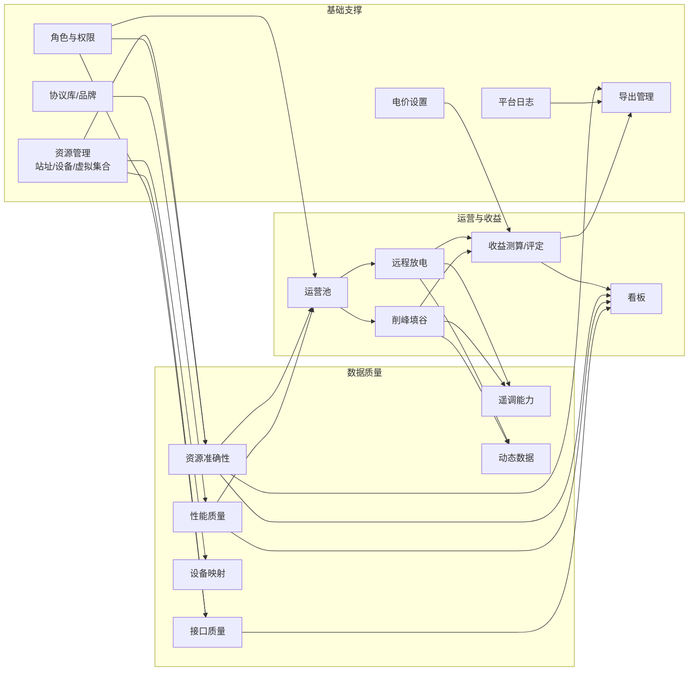
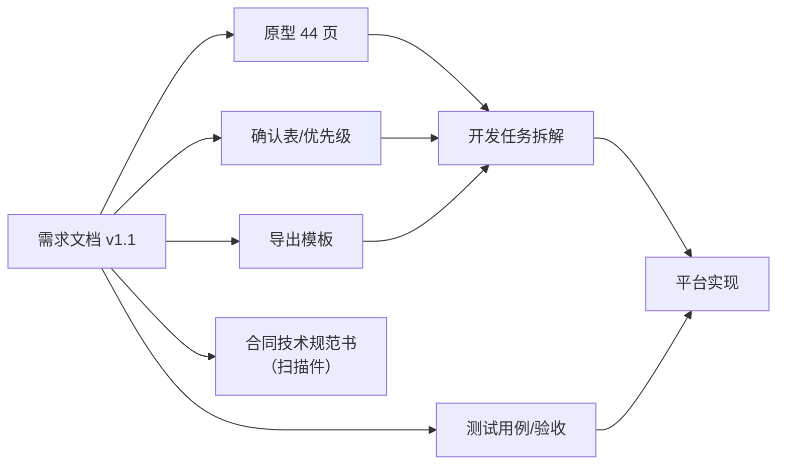

# 08 · 依赖关系

## 8.1 外部系统依赖

| 外部系统 | 方向 | 用途 | 关键约束 | 仓库内证据 |
| --- | --- | --- | --- | --- |
| 动环 A 接口 / 共享平台 | 入站 | 站址、设备、资源、性能数据 | 每天凌晨同步；客户要求改为共享平台订阅形式 | 需求 3.1、4.1.1、确认表 |
| 综资系统 | 入站（Excel） | 静态台账：设备编码、厂商、型号等 | 人工导出后导入；按需 | 需求 4.1.1 |
| 现场表 | 入站（Excel） | 现场实物盘点数据 | 人工导入；按需 | 需求 4.1.1 |
| Grafana | 入站 | 接口调用监控、成功率、延迟、并发 | 接口质量的监控过程信息与图表依赖 | 需求 4.1.7 |
| 4A | 入站 | 统一认证、地市可见性 | 4A 开放后地市可见 | 确认表 |
| EMOS / 短信网关 | 出站 | 停电、温度、起火等告警短信 | 短信模板需总公司提供；平台与 EMOS 打通待确认 | 确认表 |
| 企业微信 | 出站 | 问题规则/告警通知 | 确认表提及"问题规则企微群通知" | 确认表 |
| 高新兴 | 参考/评估对象 | 接口质量按高新兴口径评估 | 需求口径，不是仓库集成 | 确认表 |
| 广东移动平台 | 参考 | 复用广东页面/经验 | 非系统集成，仅经验参考 | 确认表、拆分稿 |
| Axure 运行时 | 本地 | 原型渲染 | 离线可用；字体 CDN 可缺省 | 原型 resources/ |
| Git LFS | 开发 | 大文件版本管理 | 克隆前需安装 | `.gitattributes` |

> 除 Axure 与 LFS 外，其余外部系统均**不在本仓库内**，也没有接口契约文件。

## 8.2 模块依赖图



## 8.3 模块依赖矩阵

| 模块 | 依赖 | 被依赖 | 依赖性质 |
| --- | --- | --- | --- |
| 资源管理 | 动环、综资、现场 | 全部评估模块 | 基础主数据 |
| 虚拟集合 | 资源管理 | 资源、性能、接口、运营、收益 | 筛选维度 |
| 协议库 | 品牌管理 | 性能质量、空调/电表运行评估 | 校验标准 |
| 资源准确性 | 资源管理、权限、导入 | 运营池、看板、导出 | 准入依据 |
| 性能质量 | 资源管理、协议库、动环性能 | 运营池、看板、导出 | 准入依据 |
| 设备映射 | 资源管理、映射维护 | 供备电评估 | 关系完整性 |
| 遥调能力 | 远程放电、削峰填谷、算法 | 运营池（参考） | 过程分析 |
| 动态数据 | 远程放电过程、算法 | 运行质量、看板 | 过程分析 |
| 接口质量 | Grafana、拓扑、权限 | 看板、导出 | 链路监控 |
| 运营池 | 资源准确性、性能质量 | 远程放电、削峰填谷 | 准入闸门 |
| 远程放电 | 运营池、资源管理、4A/EMOS | 遥调、动态、收益、电池健康 | 运营执行 |
| 削峰填谷 | 运营池、资源管理、电价 | 遥调、动态、收益 | 运营执行 |
| 收益测算/评定 | 电价、运营任务、用电数据 | 收益看板 | 效果核算 |
| 看板 | 全部评估与运营结果 | — | 展示 |
| 用户/角色 | — | 全部模块 | 权限 |
| 导出管理 | 业务模块数据 | 全部模块 | 文件交付 |
| 平台日志 | 全部操作 | — | 审计 |

## 8.4 数据依赖链

```text
动环 A 接口 ─┬─> 站址/设备资源 ─> 资源准确性 ─┐
综资 Excel ──┤                                  ├─> 运营池 ─> 远程放电/削峰填谷 ─> 收益
现场 Excel ──┘                                  │
协议库/品牌 ─> 性能质量 ─────────────────────────┘
远程放电过程 ─> 遥调能力 / 动态数据 / 电池衰减
Grafana ─> 接口质量
电价设置 ─> 收益测算/实际收益
资源管理映射 ─> 设备映射 ─> 供备电能力
```

| 数据 | 生产方 | 消费方 | 时效 |
| --- | --- | --- | --- |
| 站址/设备档案 | 动环、资源管理 | 全部 | 日更/实时 |
| 综资/现场资源 | 客户导入 | 资源准确性 | 按需 |
| 协议标准 | 协议管理 | 性能质量 | 变更后次日检测 |
| 性能采样 | 动环 | 性能质量、动态数据 | 凌晨 |
| 放电过程 | 远程放电 | 遥调、动态、电池、收益 | 任务中/后 |
| 削峰填谷过程 | 削峰填谷 | 遥调、动态、收益 | 任务中/后 |
| 通道指标 | Grafana | 接口质量 | 5 分钟 |
| 电价 | 电价设置 | 收益 | 变更即时 |
| 收益结果 | 收益评定 | 看板、导出 | 按天 |
| 权限范围 | 角色管理 | 全部 | 登录时/变更后 |

## 8.5 交付物依赖



| 交付物 | 依赖 | 缺口 |
| --- | --- | --- |
| 开发任务拆解 | 需求 + 原型 + 确认表 | 4.2/4.4–4.12 需补需求 |
| 数据库设计 | 数据模型 | 无 DDL，需从 05 章抽象 |
| 接口设计 | 动环/综资/Grafana/4A | 无 OpenAPI/Proto |
| 测试用例 | 验收标准 + 算法口径 | 多数模块无验收标准 |
| 验收 | 合同技术规范书 | PDF 为扫描件，需 OCR |
| 培训/演示 | 原型 + 看板 | 原型部分页面缺失 |

## 8.6 环境依赖

| 依赖 | 要求 | 影响 |
| --- | --- | --- |
| 操作系统 | Linux 国产操作系统 | 信创适配 |
| 数据库 | 国产化数据库 | SQL 方言、迁移工具 |
| 浏览器 | IE9+ / HTML5 | 前端兼容性 |
| 网络 | 省中心内网，地市访问 | 隐藏"省"筛选、4A 可见性 |
| Grafana | 已部署且可访问 | 接口质量不可用则模块降级 |
| 动环接口 | 可调用/可订阅 | 资源与性能数据来源 |
| 4A | 已接入 | 登录与地市权限 |
| EMOS/短信 | 已打通 | 告警通知 |
| 时间同步 | 服务器时间准确 | 5 分钟聚合、离线时长、收益日切 |

## 8.7 依赖风险

| 风险 | 影响 | 缓解 |
| --- | --- | --- |
| 动环接口变更/限流 | 资源与性能数据缺失 | 订阅化、重试、断点续传、数据质量告警 |
| 综资/现场 Excel 不规范 | 导入失败、匹配率低 | 模板校验、异常明细、样例数据 |
| 协议库不完整 | 大量设备无法评估 | 批量导入、无标准清单、标准维护流程 |
| Grafana 不可用 | 接口质量空白 | 缓存最近结果、降级提示 |
| 4A 未开放 | 地市不可见 | 分阶段开放、临时权限 |
| 短信模板未提供 | 告警无法外发 | 先用站内/企微通知 |
| 权限模型未定 | 数据越权/看不到 | 先定义角色权限矩阵 |
| 合同不可检索 | 验收争议 | OCR/索取可检索版 |
| 单一提交仓库 | 历史不可追溯 | 以备份包版本为准，建立正式分支策略 |
